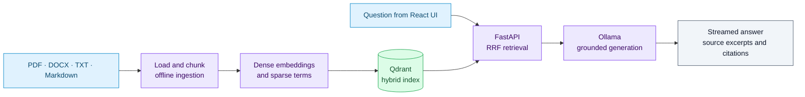
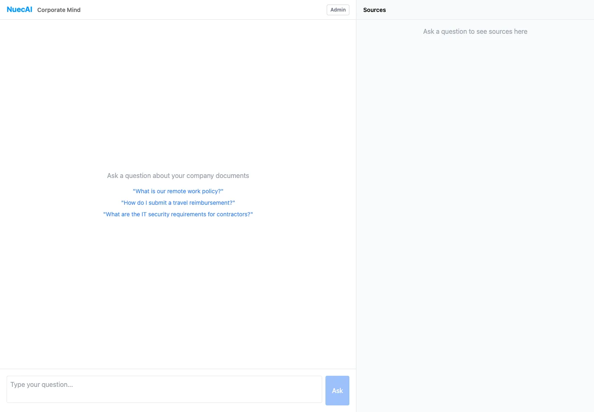
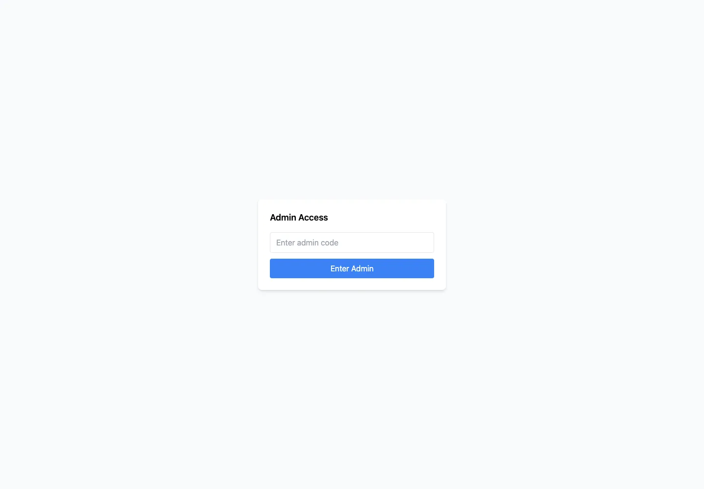

# corp-mind-ai

A secure, internal AI assistant (NuecAI) that answers questions using company documents with high accuracy, source traceability, and full on-premise operation.

## Document ingestion and answer flow

Ingestion and answering share Qdrant but run independently. Keep the embedding model identical on both paths and inspect the sources alongside each answer.



Use [USAGE.md](USAGE.md) for ingestion and troubleshooting. A running frontend proves the interface loads; document retrieval and generation also require Qdrant, the embedding model, and Ollama.

## Features

- **Hybrid Search**: Combines semantic (vector) and keyword (BM25) search via Qdrant's native RRF fusion for accurate results
- **Source Citations**: Every answer shows which documents were used, with page numbers and expandable excerpts
- **Local LLM**: Runs entirely on your machine via Ollama — no data leaves your network
- **Answer Caching**: Repeats of the same question return instant cached results (2-hour TTL)
- **Diagnostics Dashboard**: Built-in health check for Qdrant, Ollama, and collection status
- **Admin Panel**: Web-based document management — upload, list, delete, and re-ingest documents
- **Search History**: Recent queries are saved locally for quick re-asking
- **Conversation History**: Previous conversations are persisted in localStorage
- **Easy Ingestion**: Drop documents in a folder, run one command to index them

## Tech Stack

| Layer | Technology |
|-------|------------|
| Frontend | React + Vite |
| Backend | FastAPI (Python) |
| Vector DB | Qdrant (Docker) |
| LLM | Ollama (llama3.2:3b) |
| Embeddings | sentence-transformers (BAAI/bge-small-en-v1.5) |

## Quick Start

```bash
# 1. Start all services (Ollama, Qdrant, Backend, Frontend)
./scripts/start.sh

# 2. Ingest your documents
./scripts/ingest.sh --dir /path/to/your/docs

# 3. Open browser
# http://localhost:5174
```

See [USAGE.md](USAGE.md) for detailed instructions.

## Project Structure

```
corp-mind-ai/
├── .env                        # Local admin code, max file size, docs directory (untracked)
├── scripts/
│   ├── start.sh                # Start all services (one command!)
│   ├── stop.sh                 # Stop services
│   └── ingest.sh               # Ingest documents (--dir or --file)
├── backend/                    # FastAPI server (always running)
│   ├── main.py                 # App entrypoint, CORS, load_dotenv
│   ├── config.py               # Backend constants (model name, TOP_K, thresholds)
│   ├── api/                    # API routes
│   ├── services/               # Backend services and ingestion bridge
│   ├── retrieval/              # Embedding and Qdrant retrieval
│   └── generation/             # Ollama streaming and prompt construction
├── ingestion/                  # Document ingestion pipeline (offline)
│   ├── main.py                 # CLI entrypoint
│   ├── loader.py               # PDF/DOCX/TXT/MD parsing
│   ├── chunker.py              # Text chunking
│   ├── embedder.py             # Generate embeddings
│   ├── qdrant_writer.py        # Create collection + upsert to Qdrant
│   └── ingestion_config.py     # Ingestion constants
├── frontend/                   # React UI (Vite)
│   ├── src/
│   │   ├── App.jsx             # Main layout, hash routing (chat ↔ admin)
│   │   ├── components/
│   │   │   ├── ChatPanel.jsx   # Message thread, input, search history popup
│   │   │   ├── MessageBubble.jsx # Individual message with streaming + copy
│   │   │   └── SourcePanel.jsx # Source cards with expandable excerpts, confidence bar
│   │   ├── pages/
│   │   │   └── AdminPage.jsx   # Admin UI: login, upload, list, delete, reset
│   │   └── api/
│   │       ├── client.js       # SSE stream client, conversation ID support
│   │       └── history.js      # localStorage search + conversation history
│   └── package.json
│
├── docker-compose.dev.yml      # Qdrant-only Docker setup
├── docker-compose.yml          # Full local compose setup
├── README.md
└── USAGE.md
```

## Requirements

- Python 3.10+
- Node.js 18+
- Docker (for Qdrant)
- Ollama with llama3.2:3b model

## Configuration

### `.env` File

Create a `.env` file in the project root:

```env
ADMIN_CODE=replace-with-a-private-local-code
MAX_FILE_SIZE_MB=50
DOCS_DIR=./documents
```

- `ADMIN_CODE`: Secret code for admin panel access
- `MAX_FILE_SIZE_MB`: Maximum upload file size (default: 50)
- `DOCS_DIR`: Default documents directory for admin uploads

### Embedding Model

The embedding model must be **identical** in both config files:

- `ingestion/ingestion_config.py` — `EMBEDDING_MODEL`
- `backend/config.py` — `EMBEDDING_MODEL`

Current model: `BAAI/bge-small-en-v1.5` (384-dim)

### LLM Model

Edit `backend/config.py`:

```python
OLLAMA_MODEL = "llama3.2:3b"  # Change to any Ollama model
```

## Admin Panel

Access at: `http://localhost:5174/#/admin`

| Feature | Description |
|---------|-------------|
| **Login** | Enter admin code from `.env` to authenticate |
| **Upload** | Drag & drop documents (PDF, DOCX, TXT, MD) — up to 50MB each |
| **List** | View all ingested documents with their filenames |
| **Delete** | Remove individual documents from the vector store |
| **Reset** | Wipe the entire collection and re-ingest all documents |
| **Re-ingest** | Re-process all documents from the documents directory |

### Admin API Endpoints

| Method | Endpoint | Description |
|--------|----------|-------------|
| POST | `/api/admin/login` | Authenticate with admin code |
| GET | `/api/admin/documents` | List all unique document filenames |
| DELETE | `/api/admin/documents/{filename}` | Delete a specific document |
| POST | `/api/admin/documents/upload` | Upload new documents |
| POST | `/api/admin/documents/reset` | Wipe collection (requires re-ingest) |
| POST | `/api/admin/documents/reingest` | Re-ingest all documents |

## API Endpoints (Chat)

| Method | Endpoint | Description |
|--------|----------|-------------|
| POST | `/api/ask` | Non-streaming chat (with caching) |
| GET | `/api/ask/stream` | SSE streaming chat |
| GET | `/api/diagnostics` | Check Qdrant + Ollama status |
| GET | `/api/cache/stats` | View answer cache statistics |
| POST | `/api/cache/clear` | Clear the answer cache |
| GET | `/api/health` | Simple health check |

## Answer Caching

- Questions are cached for **2 hours** (configurable in `routes_ask.py`)
- Cache key: SHA-256 hash of the normalized question
- Cache is **in-memory** (simple dict) — resets on backend restart
- Use `/api/cache/clear` or restart the backend to invalidate

## Service URLs

| Service | URL |
|---------|-----|
| App (UI) | http://localhost:5174 |
| API Docs (Swagger) | http://localhost:8002/docs |
| Full Docker Compose UI | http://localhost:3000 |
| Qdrant Dashboard | http://localhost:6333/dashboard |

## License

MIT

## Local development port override

The Vite proxy targets the backend on port **8002**. With the existing backend virtual environment installed, run `./scripts/run-backend-local.sh` in one terminal and `npm run dev` from `frontend/` in another. The helper binds the API to `127.0.0.1` and writes its log to `/tmp/corp-mind-backend.log`. Docker Compose retains its own port mapping.

## Captures

Document workspace preview. Retrieval and generation not exercised.





Full capture descriptions and provenance: [captures.json](docs/screenshots/captures.json).
